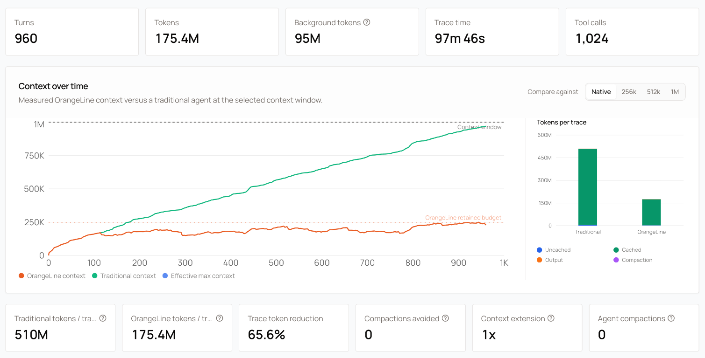

Our gateway groups requests from the same session into a conversation. A conversation is one row in the conversations page, with its turns, tokens, background tokens, tool calls, and a context-over-time chart. Correlation is what makes long agent runs readable, and it is what shows the benefit of context compression.

Send one stable session value per conversation, either in a header or in the body. The gateway accepts several forms, listed in [Session affinity](/features/session-affinity#identify-your-session) with the resolution order between them. This page covers what the conversation row shows and how to label it.

Correlation and affinity read the same session value but produce different outcomes. Correlation decides which conversation a request belongs to. Affinity decides which endpoint serves it. A request can be grouped and not pinned, or pinned and grouped under a derived key.

<Frame caption="Context growth for a single session in the conversations page. Session affinity keeps follow-up requests on the worker that holds the conversation's KV cache, so cached context accumulates instead of being re-sent.">
  
</Frame>

## Name your client

Send `x-subconscious-client` to label your traffic in usage views:

```
x-subconscious-client: my-agent
```

Any value works. The value becomes the agent label shown next to your conversations. Labels are lowercased, separators are collapsed to hyphens, and the stored label is at most 64 characters. For example, `My Agent!` shows as `my-agent`.

A present `x-subconscious-client` is the only way a request carrying generic session signals (the body session id, `x-session-id`, or `x-session-affinity`) gets a label. Those signals group requests into conversations, but the gateway never guesses which client sent them.

The client header is terminal: when it is present, its value is the label, regardless of what other signals suggest.

## Sessions from the body

Some routers and SDKs put the session id in the request body instead of a header. The gateway reads two body fields on `/v1/chat/completions`, `/v1/messages`, and `/v1/responses`. Each endpoint in the [API reference](/api-reference/chat-completions) lists these fields and the headers it accepts.

### session_id

A top-level `session_id` follows the same rules as a session header: 8 to 256 characters, one fresh value per conversation.

Two other spellings resolve to the same field: `sessionId`, and `providerOptions.gateway.sessionId`, the Vercel AI SDK convention. Clients built for the [Vercel AI Gateway session convention](https://vercel.com/docs/ai-gateway/models-and-providers/session-affinity) or OpenRouter work without changes. Read [Provider Options](https://ai-sdk.dev/docs/foundations/provider-options) for the SDK shape.

A body session id groups requests like a session header does. When both a body session id and the generic session headers are present, the body wins. It never names your client: send `x-subconscious-client` for that. The value is not forwarded to upstream providers.

### prompt_cache_key

`prompt_cache_key` is an optional request field on `/v1/chat/completions` and `/v1/responses`. It is the last resort: it groups requests only when no session header and no body session id are present.

Clients often set it to a static per-user value, so two conversations on one API key can land in the same conversation row. Send a session header or a body session id instead.

## Your own session header

Pick a header name that names your application, ending in `-session-id` and starting with `x-`. For example, an integration built on LangChain could send:

```
x-langchain-session-id: 7f2c9e1a-4b8d-4f7a-9c3d-2e5b8a1f6d90
```

Any header of the form `x-<name>-session-id` is accepted, as long as the name is not reserved (see [Headers to avoid](#headers-to-avoid)). The gateway treats it as your session identity.

<Note>
The header is optional. When a request carries no `x-<name>-session-id` header, the gateway uses the body session id (`session_id`, `sessionId`, or `providerOptions.gateway.sessionId`) and then `prompt_cache_key` where the endpoint accepts it. A body session id on the same request overrides this header.
</Note>

The `<name>` part also becomes the agent label shown next to your conversations, so `x-langchain-session-id` shows as `langchain`. Pick the name your users should see. Use lowercase letters, digits, hyphens, and underscores. Values are lowercased before they are stored.

Follow these rules for the value:

- Mint a fresh value when a conversation starts, such as a UUID. Do not reuse values across conversations.
- Send the same value on every request that belongs to that conversation, including retries and tool-loop turns.
- Keep the value between 8 and 256 characters. Shorter or longer values are ignored.
- The header is read before any protocol translation, so it works the same on `/v1/chat/completions`, `/v1/messages`, and `/v1/responses`.

<CodeGroup>

```python Python (OpenAI SDK)
from openai import OpenAI

client = OpenAI(
    api_key="your-api-key",
    base_url="https://api.subconscious.dev/v1",
)

session_id = "7f2c9e1a-4b8d-4f7a-9c3d-2e5b8a1f6d90"

response = client.chat.completions.create(
    model="subconscious/glm-5.3-marathon",
    messages=[{"role": "user", "content": "Refactor this function."}],
    extra_headers={"x-langchain-session-id": session_id},
)
```

```typescript Node.js (OpenAI SDK)
import OpenAI from "openai";

const client = new OpenAI({
  apiKey: "your-api-key",
  baseURL: "https://api.subconscious.dev/v1",
  defaultHeaders: {
    "x-langchain-session-id": "7f2c9e1a-4b8d-4f7a-9c3d-2e5b8a1f6d90",
  },
});

const response = await client.chat.completions.create({
  model: "subconscious/glm-5.3-marathon",
  messages: [{ role: "user", content: "Refactor this function." }],
});
```

</CodeGroup>

There are two ways to name your client in usage views. The `<name>` of your session header is one. The other is `x-subconscious-client`, described in [Name your client](#name-your-client), which also covers clients that send generic session signals.

## Conversations without a session signal

A request that sends no session signal still gets a conversation. The gateway derives one from the assistant turn this request continues, or from the prompt text itself. That path costs more lookups, and the conversation is scoped to the chain the gateway inferred. Read [Sessions without a session signal](/features/session-affinity#sessions-without-a-session-signal) for the mechanism.

Two consequences matter here. A derived conversation has no client label, so send `x-subconscious-client` if you need one. And a derived conversation can split when a client sends a fresh history that matches nothing, which is why a session header is worth the effort.

## Headers to avoid

These header names are reserved for specific clients or for internal gateway routing. Sending them from a custom application has no officially supported behavior.

| Header | Why to avoid it |
| --- | --- |
| `x-subconscious-session-id` | Reserved for internal gateway routing. A request carrying it is treated as forwarded by another Subconscious gateway. |
| `x-claude-code-session-id` | Reserved for the Claude Code client. It labels your traffic as Claude Code. |
| `x-subconscious-code-session-id` | Reserved for the Subconscious Code client. |

The rule is simple: use one `x-<name>-session-id` header of your own, and send nothing from the list above.

## Next steps

- [Session affinity](/features/session-affinity): keep each conversation on the worker that holds its cache.
- [Subagent correlation](/features/subagent-correlation): nest spawned conversations under their parent.
