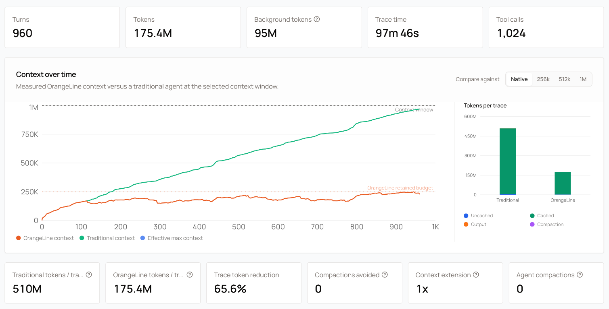
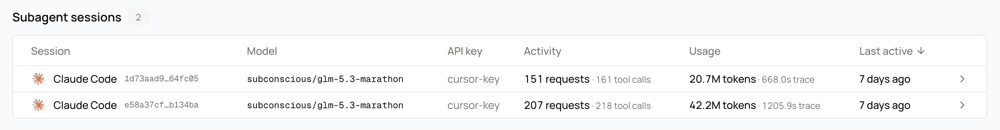

Our system is built to serve long-context, multi-turn conversations. When serving multi-turn conversations, it is important to continually route the follow-up requests to the same GPU that served the previous request, to optimize for KV cache hit ratios.

Our gateway groups requests from the same session into "conversations" and routes follow-up LLM requests to the same GPU workers. There are ways to provide session headers to our inference service that make this more consistent and efficient.

Additionally, with proper session-affinity, you will get the most consistent request-correlation experience in the conversations page, demonstrating the benefits of our context compression.

<Frame caption="Context growth for a single session in the conversations page. Session affinity keeps follow-up requests on the GPU that holds the conversation's KV cache, so cached context accumulates instead of being re-sent.">
  
</Frame>

## Custom agent applications

Pick a header name that names your application, ending in `-session-id` and starting with `x-`. For example, an integration built on LangChain could send:

```
x-langchain-session-id: 7f2c9e1a-4b8d-4f7a-9c3d-2e5b8a1f6d90
```

Any header of the form `x-<name>-session-id` is accepted, as long as the name is not reserved (see [Headers to avoid](#headers-to-avoid)). The gateway treats it as your session identity.

The `<name>` part also becomes the agent label shown next to your conversations in usage views, so `x-langchain-session-id` shows as `langchain`. Pick the name your users should see. Use lowercase letters, digits, hyphens, and underscores. Values are lowercased before they are stored.

Follow these rules for the value:

- Mint a fresh value when a conversation starts, such as a UUID. Do not reuse values across conversations.
- Send the same value on every request that belongs to that conversation, including retries and tool-loop turns.
- Keep the value between 8 and 256 characters. Shorter or longer values are ignored.
- The header is read before any protocol translation, so it works the same on `/v1/chat/completions`, `/v1/messages`, and `/v1/responses`.

If you want to correlate one specific request in your own logs, send `x-client-request-id` alongside the session header. It identifies a single request, not a conversation.

<CodeGroup>

```python Python (OpenAI SDK)
from openai import OpenAI

client = OpenAI(
    api_key="your-api-key",
    base_url="https://api.subconscious.dev/v1",
)

session_id = "7f2c9e1a-4b8d-4f7a-9c3d-2e5b8a1f6d90"

response = client.chat.completions.create(
    model="subconscious/glm-5.3-marathon",
    messages=[{"role": "user", "content": "Refactor this function."}],
    extra_headers={"x-langchain-session-id": session_id},
)
```

```typescript Node.js (OpenAI SDK)
import OpenAI from "openai";

const client = new OpenAI({
  apiKey: "your-api-key",
  baseURL: "https://api.subconscious.dev/v1",
  defaultHeaders: {
    "x-langchain-session-id": "7f2c9e1a-4b8d-4f7a-9c3d-2e5b8a1f6d90",
  },
});

const response = await client.chat.completions.create({
  model: "subconscious/glm-5.3-marathon",
  messages: [{ role: "user", content: "Refactor this function." }],
});
```

</CodeGroup>

There are two ways to name your client in usage views. The `<name>` of your session header is one. The other is a dedicated client header, described next, which also covers clients that use generic session signals.

## Name your client

Send `x-subconscious-client` to label your traffic in usage views:

```
x-subconscious-client: my-agent
```

Any value works. The value becomes the agent label shown next to your conversations. Labels are lowercased, separators are collapsed to hyphens, and the stored label is at most 64 characters. For example, `My Agent!` shows as `my-agent`.

A present `x-subconscious-client` is the only way a request carrying generic session signals (the body session id, `x-session-id`, or `x-session-affinity`) gets a label. Those signals group requests into conversations, but the gateway never guesses which client sent them. The `x-parent-session-id` header nests the request under the conversation whose session id it names, the same way the canonical parent header does. The client header is also terminal: when it is present, its value is the label, regardless of what other headers would suggest.

## Body-driven session affinity

Some routers and SDKs put the session id in the request body instead of a header. The gateway reads two body fields on `/v1/chat/completions`, `/v1/messages`, and `/v1/responses`.

### session_id

A top-level `session_id` follows the same rules as a session header: 8 to 256 characters, one fresh value per conversation.

Two other spellings resolve to the same field: `sessionId`, and `providerOptions.gateway.sessionId`, the Vercel AI SDK convention. Clients built for the OpenRouter or Vercel AI Gateway session conventions therefore work without changes.

A body session id groups requests like a session header does. When both a body session id and the generic session headers are present, the body wins. It never names your client: send `x-subconscious-client` for that. The value is not forwarded to upstream providers.

### prompt_cache_key

`prompt_cache_key` is an optional request field on `/v1/chat/completions` and `/v1/responses`. It is a fallback: it groups requests only when no session header or body session id is present.

Clients often set it to a static per-user value, so two conversations on one API key can land in the same conversation row. We recommend a session header or a body session id instead.

## Subagents

An agent that spawns a subagent sends two independent streams of requests. The subagent starts with its own system prompt and its own history, so it cannot reuse the parent session header. Without a nest signal the gateway records the subagent as a separate top-level conversation.

Give each spawned subagent its own session id, and name the parent's. The parent header must use the same `<name>` as the session header. A parent header whose `<name>` does not match the session header is ignored.

```
x-langchain-session-id: 4b8d2f0a-91c4-4e7a-b3d2-8f1e6c5a9d21
x-langchain-parent-session-id: 7f2c9e1a-4b8d-4f7a-9c3d-2e5b8a1f6d90
```

The first value is the subagent's own session id. The second value is the session id of the conversation that spawned it, exactly as that conversation sends it.

Follow these four rules:

- Give each spawned subagent a fresh session id of its own. Never reuse the parent's session id for a child.
- The parent value is the parent's session id exactly as the parent sends it. Do not transform it.
- Point at the conversation that directly spawned the subagent, not at the root of the whole run. A subagent of a subagent names its immediate parent.
- The link fills in on a later request if the subagent's first request arrives before its parent has sent anything.

The subagent conversation nests under the spawning conversation instead of appearing top-level. The parent conversation lists its subagents in a **Subagent sessions** table, and each row links to the child conversation.

<Frame caption="Subagent sessions for one conversation. Each row is a subagent conversation with its own model, request count, tool calls, and token usage.">
  
</Frame>

## Headerless session affinity

When you are unable to provide a session header like above for some reason, our gateway will use prefix hash and other heuristic measures to attempt to correlate requests into a session. This is generally quite reliable, but it requires more DB and cache lookups to serve inference, which can lead to a slight decrease in throughput.

For this reason, we recommend providing a consistent header format to optimize your end-user experience.

## Coding agents

Coding agents like Claude Code, Codex, OpenCode, and Pi natively send out session ids for long running workloads, so this session affinity should work out of the box. We recommend using these agents in context with our CLI to enhance the experience. This will make it easier to auto-discover model capabilities and route inference requests to our servers.

```
npm install -g subconscious-cli
subc login
subc claude
# subc codex
# subc opencode
# subc pi
```

## Headers to avoid

These header names are reserved for specific clients or for internal gateway routing. Sending them from a custom application has no officially supported behavior.

| Header | Why to avoid it |
| --- | --- |
| `x-subconscious-session-id` | Reserved for internal gateway routing. A request carrying it is treated as forwarded by another Subconscious gateway. |
| `x-claude-code-session-id` | Reserved for the Claude Code client. It labels your traffic as Claude Code. |
| `x-subconscious-code-session-id` | Reserved for the Subconscious Code client. |

The rule is simple: use one `x-<your-app>-session-id` header of your own, and send nothing from the list above.
