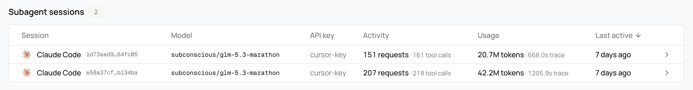

An agent that spawns a subagent sends two independent streams of requests. The subagent starts with its own system prompt and its own history, so it cannot reuse the parent's session id. Without a nest signal the gateway records the subagent as a separate top-level conversation, and the work it did reads as unrelated traffic.

Subagent correlation fixes that. A spawned conversation nests under its parent, and the parent lists its subagents in a **Subagent sessions** table, where each row links to the child conversation.

<Frame caption="Subagent sessions for one conversation. Each row is a subagent conversation with its own model, request count, tool calls, and token usage.">
  
</Frame>

## Send the pair

Give each spawned subagent its own session id, and name the parent's. The parent header must use the same `<name>` as the session header. A parent header whose `<name>` does not match the session header is ignored.

```
x-langchain-session-id: 4b8d2f0a-91c4-4e7a-b3d2-8f1e6c5a9d21
x-langchain-parent-session-id: 7f2c9e1a-4b8d-4f7a-9c3d-2e5b8a1f6d90
```

The first value is the subagent's own session id. The second value is the session id of the conversation that spawned it, exactly as that conversation sends it.

Read [Request correlation](/features/request-correlation#your-own-session-header) for the naming and value rules on the session header.

Follow these four rules:

- Give each spawned subagent a fresh session id of its own. Never reuse the parent's session id for a child.
- The parent value is the parent's session id exactly as the parent sends it. Do not transform it.
- Point at the conversation that directly spawned the subagent, not at the root of the whole run. A subagent of a subagent names its immediate parent.
- The link fills in on a later request if the subagent's first request arrives before its parent has sent anything.

## With off-the-shelf headers

When you use `x-session-id` or `x-session-affinity` as the session signal, `x-parent-session-id` carries the parent pointer on its own. It needs no matching `<name>`, because the generic session headers have no name to match.

```
x-session-id: 4b8d2f0a-91c4-4e7a-b3d2-8f1e6c5a9d21
x-parent-session-id: 7f2c9e1a-4b8d-4f7a-9c3d-2e5b8a1f6d90
```

## Automatic nesting

Traffic that sends no session signal can still nest. A subagent's first user message is the parent's task prompt, verbatim. When the gateway serves a turn that spawned a subagent, it records that prompt, and the next conversation whose first user message matches it is joined to the parent.

This join runs only for traffic the gateway has to identify itself. A request that sends its own session header skips it entirely, because that request already says which conversation it belongs to.

The join is best effort:

- It applies only within one API key.
- It needs the parent's spawn to be recorded before the child's first request arrives. When the child arrives first, the gateway adopts it once the parent's spawn is recorded, and the parent link fills in from then on.
- If two parents claim the same task prompt, the subagent stays top-level rather than nesting under a guess.
- A child that nests this way keeps its own session identity. Nesting changes the parent link, not which conversation the child is.

Send the pair when you need nesting to be certain. Automatic nesting is a safety net for clients that cannot send it.

## What you see

The subagent conversation appears nested under the spawning conversation instead of at the top of the list. The parent conversation's **Subagent sessions** table shows each child with its own model, request count, tool calls, and token usage, and each row links to the child conversation.

## Next steps

- [Session affinity](/features/session-affinity): keep each conversation on the worker that holds its cache.
- [Request correlation](/features/request-correlation): conversations and client labels in usage views.
